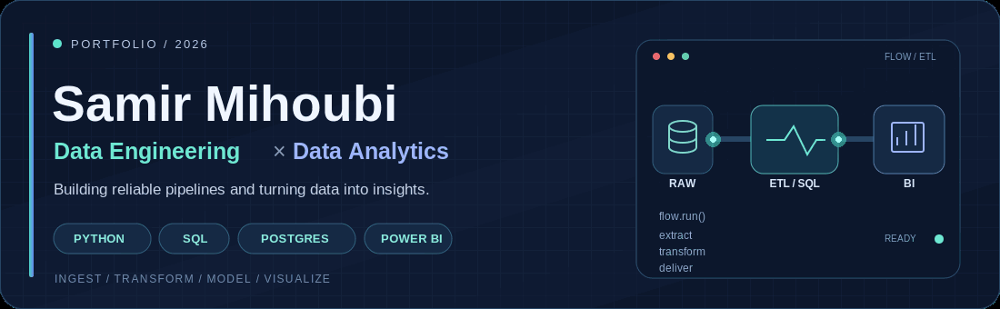
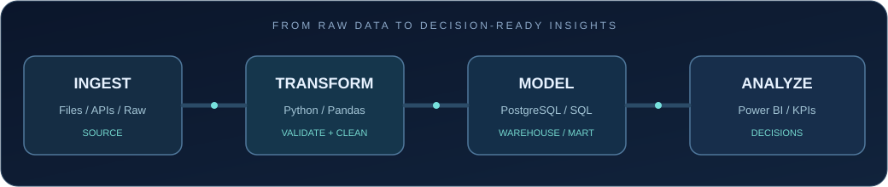

 

<strong>Master's student in Big Data &amp; Business Intelligence · Sorbonne Paris Nord University 🇫🇷</strong>

<strong>Aspiring Data Engineer · Data Analyst · BI Enthusiast</strong>

---

### 👋 About me

I'm **Samir**, a computer science graduate currently pursuing a Master's degree in **Big Data, Analytics & Business Intelligence** at **Université Sorbonne Paris Nord**.

I enjoy the full data journey: **collecting messy data, building dependable ETL pipelines, modeling it in SQL, and delivering clear analytics and dashboards**. My background in software engineering helps me approach data projects with an emphasis on maintainable code, testing and reproducibility.

- 🔧 **Engineering focus:** data ingestion, ETL, data quality, relational modeling, automation and reproducible pipelines.
- 📊 **Analytics focus:** SQL exploration, KPIs, customer segmentation, cohort analysis and Power BI dashboards.
- 🧠 **Additional interests:** anomaly detection and machine learning applied to real-world data.
- 🎓 **Currently:** Master 2 — Big Data, Analyse et Business Intelligence (BIDABI).
- 🎯 **Open to:** a **6-month Data Engineering / Data Analytics internship in 2027**.

### ⚙️ How I work with data

### 🧰 Technical toolbox

| Data engineering · primary focus | Data analytics & BI |
| :--- | :--- |
| **Python, SQL, PostgreSQL** | **Power BI, DAX, Pandas** |
| ETL workflows, data cleaning, validation | KPI reporting, exploratory analysis |
| Docker, Git, GitHub Actions | RFM segmentation, retention cohorts |
| Data modeling, relational databases | Dashboard design and business insights |
| pytest, reproducible pipelines | Data quality and descriptive analytics |

> I prefer **working, documented projects** over long lists of technologies I haven't used.

### 🚀 Selected projects

<table>
<tr>
<td width="50%" valign="top">
<h4>🏗️ <a href="https://github.com/samirmihoubi2003/dvf-idf-analytics">DVF Île-de-France — ETL &amp; Data Mart</a></h4>

An ingestion and transformation pipeline for French property transaction data, with a relational data mart and SQL analytics.

<code>Python</code> <code>PostgreSQL</code> <code>Docker</code> <code>SQL</code> <code>CI</code>

<strong>Project result:</strong> ~164k Île-de-France transactions processed for 2025.

</td>
<td width="50%" valign="top">
<h4>🛒 <a href="https://github.com/samirmihoubi2003/customer-retention-analytics">Customer Retention Analytics</a></h4>

End-to-end e-commerce data preparation and analysis: data cleaning, customer-level features, RFM segments, cohort retention and reporting.

<code>Python</code> <code>PostgreSQL</code> <code>Pandas</code> <code>Power BI</code> <code>pytest</code>

<strong>Project result:</strong> ~779k cleaned sales records and ~5.9k customers.

</td>
</tr>
<tr>
<td width="50%" valign="top">
<h4>🚲 <a href="https://github.com/samirmihoubi2003/grand-paris-mobility-lakehouse">Grand Paris Mobility Lakehouse</a></h4>

<strong>In progress.</strong> A data-engineering project exploring the architecture and quality checks for a mobility-focused lakehouse, starting from public mobility data sources.

<code>Data architecture</code> <code>Documentation</code> <code>Data quality</code>

</td>
<td width="50%" valign="top">
<h4>🛡️ <a href="https://github.com/samirmihoubi2003/memoire-ids-anomaly-detection">Intrusion &amp; Anomaly Detection</a></h4>

Machine-learning experiments for detecting anomalous network traffic, including data preprocessing and model evaluation.

<code>Python</code> <code>Machine Learning</code> <code>Isolation Forest</code> <code>Autoencoder</code>

</td>
</tr>
</table>

### 🔭 What I'm building toward

- **Reliable engineering:** automated pipelines with validation, tests and clear lineage.
- **Analytics-ready modeling:** well-defined tables and metrics that help answer business questions.
- **End-to-end delivery:** from source data to understandable dashboards.

### 🐍 Contribution activity

<!-- This animation appears after the GitHub Actions workflow runs successfully. -->

<picture>
  <source media="(prefers-color-scheme: dark)" srcset="https://raw.githubusercontent.com/samirmihoubi2003/samirmihoubi2003/output/github-snake-dark.svg" />
  <source media="(prefers-color-scheme: light)" srcset="https://raw.githubusercontent.com/samirmihoubi2003/samirmihoubi2003/output/github-snake.svg" />
  
</picture>

---

<strong>Let's connect about data pipelines, analytics and practical data projects.</strong>

<a href="https://www.linkedin.com/in/samir-mihoubi-600166232/"><strong>LinkedIn</strong></a> · <a href="https://github.com/samirmihoubi2003?tab=repositories"><strong>All repositories</strong></a>

Designed with a focus on real projects, reproducible work and readable engineering.

